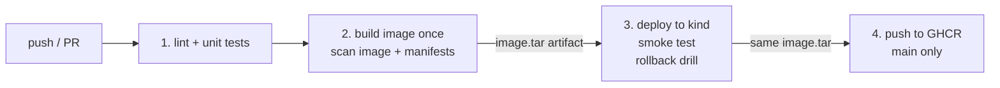

# Small DevOps Pipeline: Test, Build Once, Scan, Deploy, Roll Back, Publish

A deliberately small service wrapped in a complete delivery pipeline. It needs **no cloud account**: the deploy target is a throwaway Kubernetes cluster ([kind](https://kind.sigs.k8s.io/)) created inside the CI run, and the final artifact goes to GitHub Container Registry using the built-in `GITHUB_TOKEN`. Everything is verified by the GitHub Actions run itself.



## What each stage proves

| Stage | What it does | Why it matters |
|---|---|---|
| **1. Test** | `ruff` lint and `pytest` | Cheap failures first; nothing is built if tests fail. |
| **2. Build + scan** | Builds the image once, tags it with the git SHA, runs Trivy on the image (fixable HIGH/CRITICAL CVEs fail the build) and on the Kubernetes manifests (misconfigurations fail the build), then saves the image as an artifact. | Security checks run before anything is deployed. The image is built **once**; later stages use these exact bits. |
| **3. Deploy** | Creates a kind cluster, loads the image, applies `k8s/` with kustomize, waits for the rollout, then calls the running service and checks that `/version` equals the commit SHA. | Proves the manifests actually work and that what is running is this commit. |
| **3b. Rollback drill** | Releases a deliberately broken build (readiness probe pointed at a path that does not exist), asserts the rollout stalls, checks that the service **still serves the good version** during the stall, then runs `kubectl rollout undo` and re-checks. | Proves the safety net rather than assuming it: `maxUnavailable: 0` plus a readiness probe keeps a bad release from taking traffic. |
| **4. Publish** | On `main` only, loads the **same** image artifact and pushes `ghcr.io/<owner>/devops-pipeline-showcase:<sha>`. | Only an image that passed every earlier stage is ever published. Nothing is rebuilt. |

A real run of the drill (from the CI log):

```
== 1. releasing a build whose readiness probe fails (probe path /does-not-exist)
error: timed out waiting for the condition
== 2. rollout stalled as expected; the service must still be serving the good version
OK: running version matches 8f4858df...
== 3. rolling back
deployment "hello" successfully rolled out
OK: bad release blocked, service stayed up, rollback restored version 8f4858df...
```

## Design choices

- **Build once, promote the artifact.** Rebuilding per environment can produce a different image from the one that was tested. The tarball passes from build to deploy to publish.
- **Immutable tags.** Images are tagged with the commit SHA, never `latest`, so a running pod maps to exactly one commit.
- **Hardened workload.** Non-root user, read-only root filesystem, all Linux capabilities dropped, no privilege escalation, `RuntimeDefault` seccomp, no service-account token, CPU and memory limits. The manifest scan runs on every build and fails it on HIGH or CRITICAL findings; lower-severity settings are not enforced.
- **Least-privilege CI.** The workflow default is `contents: read`; only the publish job gets `packages: write`, and only on `main`.
- **Pinned supply chain.** The Trivy action is pinned to a commit SHA, Python dependencies are pinned, and Dependabot proposes updates for Actions, pip and the Dockerfile.
- **No cloud account needed.** kind and GHCR make the pipeline reproducible by anyone who forks the repo. Swapping the deploy stage for AKS, EKS or GKE changes the credentials and the `kubectl` context, not the stage structure (see my [Azure pipeline](https://github.com/Sup3rMar10/azure-cicd-showcase) for the OIDC and Terraform version).

## Run it locally

```bash
python -m venv .venv && source .venv/bin/activate        # Windows: .venv\Scripts\activate
pip install -r requirements-dev.txt
ruff check . && pytest -q

# with Docker, kind and kubectl installed:
docker build --build-arg APP_VERSION=local -t hello-pipeline:local app
kind create cluster --name demo && kind load docker-image hello-pipeline:local --name demo
sed -i 's/newTag: .*/newTag: local/' k8s/kustomization.yaml && kubectl apply -k k8s
kubectl rollout status deployment/hello && scripts/smoke.sh local && scripts/rollback_drill.sh local
```

## Limitations (what this is not)

- **kind is not production.** One node inside a CI runner, no real load balancer, ingress, autoscaling or multi-node scheduling. It proves the manifests and rollout behaviour, not capacity.
- **Deploy is not continuous to a live environment.** The cluster is destroyed when the job ends. There is no persistent staging or production, no approval gate and no GitOps controller.
- **The rollback drill simulates a bad release.** It breaks the probe path rather than shipping a real regression, which makes it deterministic but narrower than real failures (a crash loop, a slow memory leak or a bad database migration would behave differently).
- **The smoke test is shallow.** It checks the version endpoint only, not business behaviour.
- **No image signing or SBOM yet,** and no separate dev/prod environments.
- **The app is trivial on purpose.** The three endpoints exist so the pipeline has something to build, deploy and check.

## Next steps

1. Sign the image (cosign, keyless via OIDC) and attach an SBOM, then verify the signature before deploy.
2. Add a persistent environment (for example AKS) with an approval gate, using OIDC instead of stored credentials.
3. Replace `kubectl apply` with a GitOps controller (Argo CD or Flux).
4. Add canary or blue-green rollout with automatic rollback on an error-rate signal.

## Layout

```
app/                 the service, its tests and Dockerfile (multi-stage, non-root)
k8s/                 Deployment, Service, kustomization (the pipeline sets the image tag)
scripts/smoke.sh     calls the running service and checks the version
scripts/rollback_drill.sh   ships a broken release, checks the service stays up, rolls back
.github/workflows/pipeline.yml   the four-stage pipeline
.github/dependabot.yml           weekly dependency updates
```
